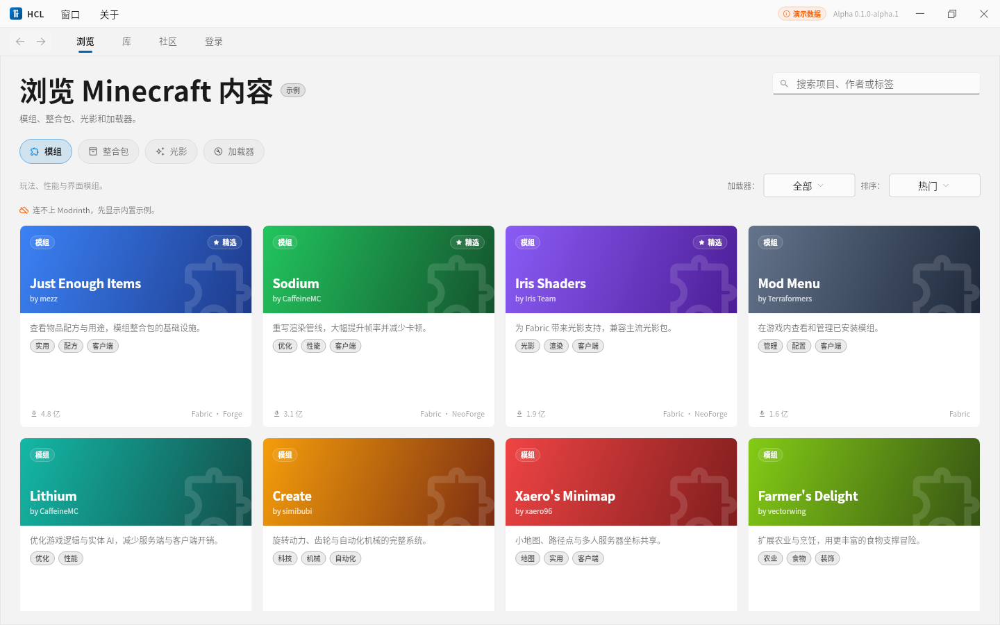
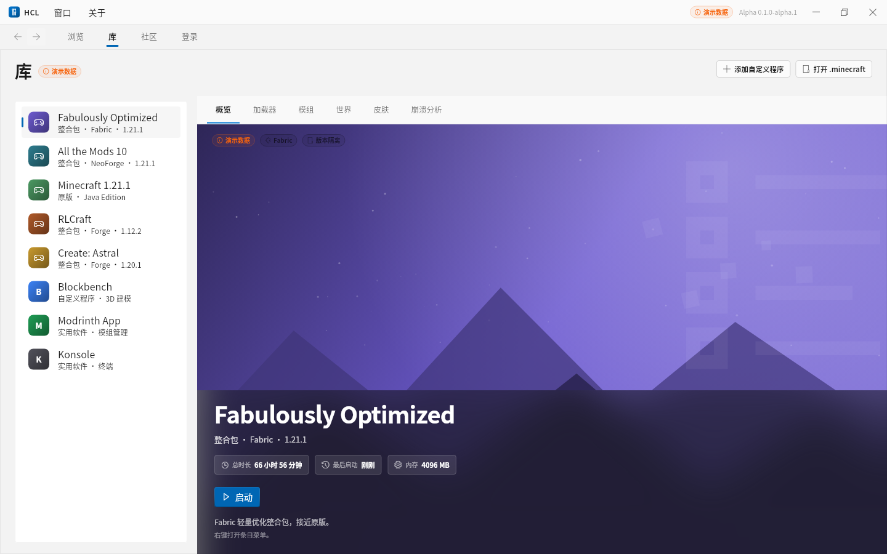
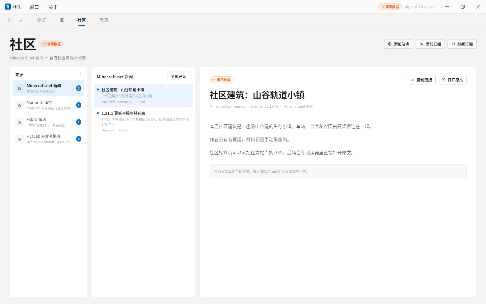
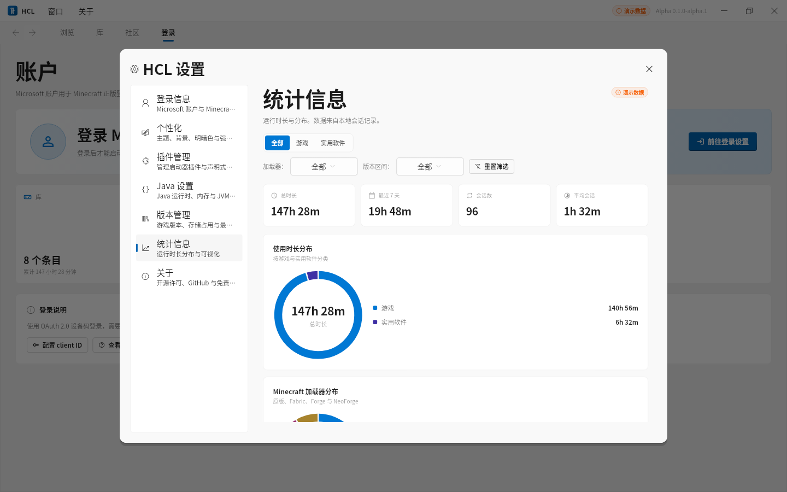
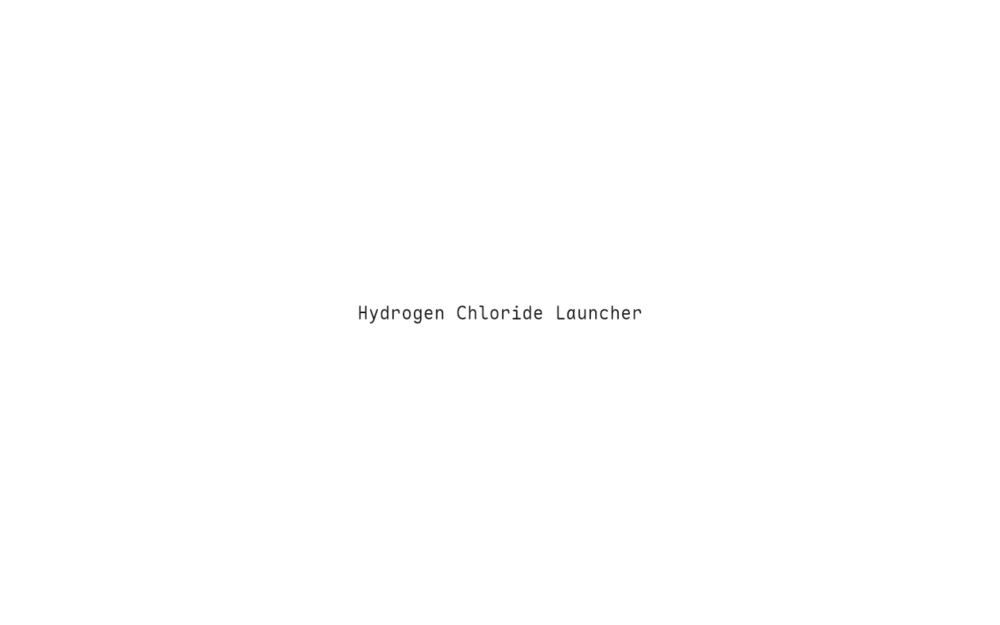

# Hydrogen Chloride Launcher

跨平台 Java 程序启动器。当前版本 `0.1.0-alpha.1`。界面、微软登录、游戏下载与真实启动、加载器安装、Modrinth 下载、RSS 订阅、世界修复、崩溃分析、下载源切换与自动更新均已可用。

> “演示数据”开关打开时，库与社区会附带内置示例条目；联不上 Modrinth 时浏览页也会退回示例。安装的版本、下载的模组与添加的订阅都会写入真实磁盘与账户。

## 界面预览

| 浏览 | 库 |
| --- | --- |
|  |  |

| 社区 | 统计信息 |
| --- | --- |
|  |  |

开屏：



更多截图见 `docs/images/`（登录、个性化、插件、Java、版本、关于与暗色主题）。

## 能力矩阵

| 能力 | 状态 | 说明 |
| --- | --- | --- |
| Fluent 界面、亮/暗主题、背景图片、透明度、高斯模糊/亚克力 | 已实现 | 纯白亮色、纯黑暗色，强调色可调 |
| 自绘标题栏、窗口菜单、Steam 式顶栏 | 已实现 | 窗口/关于；浏览/库/社区/用户名 |
| 浏览、库、社区三栏阅读器、设置七个分区 | 已实现 | 完整界面与交互 |
| 设置、账户、会话、订阅、插件状态持久化 | 已实现 | JSON 文件 + 系统钥匙串 |
| 微软登录 → Xbox Live → XSTS → Minecraft | 已实现 | 内置公开 client ID，设备码登录（PCL2 同款，开箱即用）；也可换成自建 Azure 应用走浏览器登录 |
| 令牌存储 | 已实现 | Secret Service / DPAPI，不可用时回退 0600 文件 |
| 未登录禁止启动 Minecraft | 已实现 | 自定义程序与实用软件不受影响 |
| Java 扫描、目录占用、SHA-256、密钥存储 | 已实现 | 纯 Dart，无需额外运行时 |
| 插件清单、启停、安装/卸载、声明式页面 | 已实现 | 不执行第三方代码 |
| 游戏下载 | 已实现 | 版本 JSON、客户端、libraries、natives、资源；SHA-1 校验、断点续传、并发 |
| 真实启动 | 已实现 | classpath 与参数模板、独立日志、退出后记录时长 |
| Java 运行时下载 | 已实现 | 本机缺版本时从 Mojang 下载 JRE 到 `runtime/` |
| 加载器安装 | 已实现 | 安装版本时可选 Fabric/Forge/NeoForge 一并安装；OptiFine 导入 jar |
| 多目录管理 | 已实现 | 设置中添加多个 .minecraft，版本合并展示 |
| 安装模块化 | 已实现 | 同级 `HCL-Plugins/` 提供安装能力，可停用 |
| 在线内容 | 已实现 | Modrinth 搜索，按实例版本/加载器安装；`.mrpack` 整合包 |
| 社区订阅 | 已实现 | RSS 2.0 / Atom 抓取与解析 |
| 模组管理 | 部分实现 | 本地 mods 添加、启停、删除 |
| 世界管理 | 已实现 | 列表、备份、删除、`level.dat` 检查与修复 |
| 皮肤 | 部分实现 | 本地库、预览与上传到 Microsoft 账户；披风未实现 |
| 崩溃分析 | 已实现 | 结构化规则集，含启动器自身日志 |
| 统计饼图/直方图/折线图 | 已实现 | 基于真实会话记录，CustomPainter 绘制 |
| 下载源切换 | 已实现 | 元数据与游戏文件分别可选官方 / BMCLAPI / MCIM |
| 自动更新 | 已实现 | 更新清单检查、下载、SHA-256 校验、替换并重启 |
| 离线账户 | 不支持 | 按交付要求保持微软门禁 |
| Windows 实机构建、签名安装包 | 未实现 | 脚本与 CI 已就绪，需安装 Flutter + VS Build Tools |

## 界面结构

- **浏览**：模组、整合包、光影、加载器四类；搜索结果来自 Modrinth，支持加载器筛选、排序；项目详情可选择实例并直接安装。
- **库**：右上角「安装版本」（可附带加载器）；Steam 式“列表 + 主视觉”，不提供浏览全部游戏的卡片视图。整合包复用启动器背景图，Minecraft 版本使用 minecraft.net 官方 Java & Bedrock 封面（首次启动下载并缓存到 `<data>/covers/`），非游戏类纯黑。右键菜单包含启动、打开目录、Java 设置、JVM 设置、属性、移除。
- **社区**：Thunderbird 式三栏（来源 / 文章 / 阅读器），支持添加站点与 RSS/Atom 订阅，添加后立即抓取，可手动刷新。
- **顶栏**：使用 `fluent_ui` 的 `NavigationView(PaneDisplayMode.top)`；四个选项卡无前置图标，最前面是 Steam 式前进/后退按钮；设置不占导航项，入口位于 HCL 标题。
- **$用户名**：导航栏标签动态显示已登录的 Microsoft 账户名；账户页提供登录、刷新与退出。
- **设置**：点击顶部 **HCL** 标题打开 Steam 式模态设置窗口；左侧分区导航，右侧 `ScaffoldPage.scrollable` 内容；包含登录信息、个性化、插件管理、Java 设置、版本管理、统计信息、关于七项。
- **版本隔离**：库条目可开启 HMCL 风格隔离，mods/config/saves 放到 `versions/<版本>/` 下。
- **库详情管理**：右侧顶部选项卡切换到加载器、模组、世界、皮肤、崩溃分析，不再使用弹窗。
- **开屏与过渡**：开屏为纯文本全称 + 强调色背景；标签页、设置分区和开屏切换使用 Fade/Slide 过渡。

## 技术栈

- Flutter 3.47 / Dart 3.13
- `fluent_ui` 4.17（FluentApp、NavigationView、ScaffoldPage、Card、ToggleSwitch/Slider/TextBox）
- 纯 Dart 实现，单一二进制产物，无额外工具链
- `window_manager`、`file_selector`、`http`、`url_launcher`、`package_info_plus`
- `archive`（natives/jar/.mrpack/更新包）、`crypto`（SHA-1/SHA-256）、`xml`（RSS/Atom）
- 状态管理使用内置 `ChangeNotifier`，图表使用 `CustomPainter`；不使用 Material `Scaffold` 手拼结构

## 目录

```text
lib/
  core/
    minecraft/   版本的清单/JSON、下载器、镜像、安装器、启动器、加载器、Modrinth
    models/      设置、条目、账户、会话、订阅、插件清单
    services/    存储、统计、登录、钥匙串、崩溃规则、世界修复、更新
    config/      AppPaths、JsonStore
  state/        AppState、InheritedNotifier
  theme/        Fluent 令牌、亚克力背景、GlassPanel
  ui/           shell、browse、library、community、account、settings
docs/           快速使用、插件开发、架构说明、HMCL 对照
examples/plugins/hello-hcl/  可安装的示例插件
test/           单元测试；live_*.dart 为真实网络/Java 集成检查
```

## HMCL 功能对照

已实现与未实现的功能见 [docs/hmcl-parity.md](docs/hmcl-parity.md)。

## 快速开始

```bash
flutter pub get
flutter run -d linux    # 或 -d windows
```

安装能力由同级目录 `HCL-Plugins/hcl-plugin-installer` 提供，需与该仓库保持同级。

Linux 需要 `clang cmake ninja-build pkg-config libgtk-3-dev liblzma-dev`。完整步骤、微软 client ID 配置与故障排查见 [docs/quick-start.md](docs/quick-start.md)。

## 插件

Alpha 插件由 `plugin.json` 清单和声明式组件组成，启动器负责渲染，不加载动态代码。规范与示例见 [docs/plugin-development.md](docs/plugin-development.md)；可安装示例位于 `examples/plugins/hello-hcl/`。

## 交付说明

完整的需求覆盖、真实/演示边界与本轮验证记录见 [docs/alpha-delivery.md](docs/alpha-delivery.md)。

## 验证命令

```bash
dart format --set-exit-if-changed lib test
flutter analyze
flutter test
flutter build linux --release
```

真实网络与 Java 集成检查（需要网络与 Java，默认跳过）：

```bash
HCL_LIVE=1 flutter test test/live_network_test.dart test/live_launch_test.dart
```

Windows 构建脚本见 `tool/build_windows.ps1` 与 `docs/build-and-package.md`；当前构建机缺少 Flutter Windows 与 VS Build Tools，未产出 Windows 二进制。

## 存储位置

- Linux：`~/.config/hyalab/hydrogen-chloride-launcher` 与 `~/.local/share/hyalab/hydrogen-chloride-launcher`
- Windows：`%APPDATA%\HyaLab\HydrogenChlorideLauncher` 与 `%LOCALAPPDATA%\HyaLab\HydrogenChlorideLauncher`

令牌优先存入系统钥匙串（Linux Secret Service / Windows DPAPI）；钥匙串不可用时回退到权限为 `0600` 的 JSON 文件。

Minecraft 游戏文件写入设置中第一个 `.minecraft` 目录；下载的 Java 运行时位于其下的 `runtime/`。

## 许可证与免责声明

GNU General Public License v3.0（GPL-3.0-only）。本项目自 `0.1.0-alpha.1` 起由 MIT 迁移到 GPLv3；此前按 MIT 发布的副本继续适用 MIT。

本项目是非官方第三方启动器，与 Mojang Studios、Microsoft 或任何模组/整合包作者无隶属关系。Minecraft 是 Mojang Studios 的商标。使用本软件下载、安装和启动的内容由用户自行负责。

界面使用 Maple Mono NF CN 字体，该字体按 SIL Open Font License 授权，许可证文本位于 `assets/fonts/MapleMono-LICENSE.txt`。
